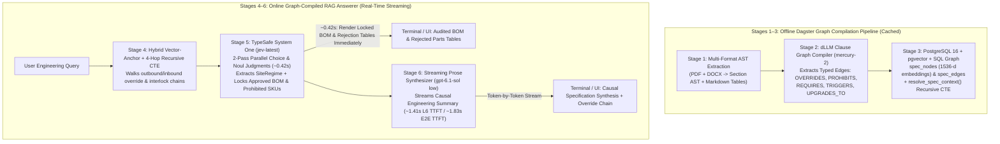

# Borealis Graph-Compiled Specification RAG

A Graph-Compiled Specification Retrieval-Augmented Generation (RAG) system built with **Dagster**, **PostgreSQL (`pgvector` + Recursive CTEs)**, **Diffusion LLMs (`mercury-2`)**, **TypeSafe System One (`jev-latest`)**, and **OpenAI (`gpt-6.1-sol`)** to resolve multi-hop engineering specification overrides and Tier-3 safety interlocks without leaking prohibited baseline parts.

---

## Why Naive Vector RAG Fails on Engineering Specifications

Industrial engineering specifications are organized into strict **precedence hierarchies**:
- **Tier 1 (General & Baseline Schedule — Volume 1):** Standard temperate materials and baseline component SKUs (`SEC-1.1` – `SEC-3.3`).
- **Tier 2 (Environmental Excursion Overrides — Volume 2):** Cryogenic (`< -30°C` / `< -29°C` / `< -35°C`) and polar-solvent (anhydrous methanol) material substitutions that **prohibit** and **supersede** Tier 1 baseline SKUs (`SEC-4.1` – `SEC-4.5`).
- **Tier 3 (Safety Interlocks & Emergency Shutdown Directives — Volume 2):** Secondary mechanical hazard overrides triggered by Tier 2 substitutions—such as ultra-low-temperature perfluoroelastomer (`#SEAL-FFKM-ULT90`) increasing valve stem breakaway torque by `185%` (`215 Nm` at `-40°C`), stalling standard `120 Nm` pneumatic actuators (`#ACT-PN-100`) and mandating a `400 Nm` hydraulic actuator (`#ACT-HYD-350`) (`SEC-5.1` – `SEC-5.2`).

When an engineer asks for a Bill of Materials (BOM) for **Manifold Loop B at `-42°C` and `120 PSI`**, **Naive Top-$K$ Vector RAG** retrieves the highest cosine-similarity baseline table (`SEC-2.2`) and recommends prohibited Tier 1 components (`#VLV-100-CS`, `#SEAL-VT-09`, `#ACT-PN-100`) that suffer brittle fracture, `>45%` methanol swell/extrusion, or emergency-shutdown actuator stall.

---

## 6-Layer Architecture



### Key Architectural Decisions

1. **PostgreSQL Hybrid Vector-Anchor + Cycle-Safe Recursive CTE (`resolve_spec_context`)**:
   - Seeds the traversal with the top-$K$ vector-similar clauses in `spec_nodes`, then recursively walks both outbound and inbound `OVERRIDES`, `PROHIBITS`, `REQUIRES`, `TRIGGERS`, `UPGRADES_TO`, and `REFERENCES` edges in `spec_edges` up to 4 hops while tracking `visited_path` to prevent cycles.
2. **Layer 4/5: TypeSafe System One (`jev-latest`) Two-Pass Parallel Judgment Engine (`~0.42s`)**:
   - Replaces brittle manual regex extractors and Python `eval()` string predicates with two single-token shared-prefix batch calls to `TypeSafeClient.system_one(model="jev-latest")`:
     - **Pass 1 (`Choice` + `Noul`)**: Extracts the structured `SiteRegime` (`loop_id`, `ambient_temp_c`, `pressure_psi`, `methanol_present`) directly from candidate document spans and chemical dosing tables (`SEC-1.2`, `SEC-3.2`, `SEC-3.3`).
     - **Pass 2 (Parallel `Noul` + `Choice`)**: Evaluates every retrieved `SEC-*` clause and every candidate `PART:*` SKU (`active`, `prohibited`, `not_applicable`, plus governing clause) in parallel in a single forward pass.
   - Python deterministically constructs the `recommended_bom`, `rejected_baseline_parts`, and `multi_hop_override_chain` tables directly from Jev's typed decisions—guaranteeing **zero rationale hallucination** and rendering the complete BOM tables in **`~0.42s`**.
3. **Layer 6: Pure Prose Streaming Synthesizer (`gpt-6.1-sol` on `low`)**:
   - Receives the locked Layer 4/5 BOM and rejection decisions and streams **only** the `executive_summary` prose (`stream=True`), achieving **`~1.41s` Layer 6 TTFT** (**`~1.83s` End-to-End Prose TTFT**) without modifying or overriding Layer 4/5's part selections.

---

## Golden QA Benchmark Results (`evals/borealis_golden_qa.json`)

All arms are graded holistically over the full rendered terminal report (`display_rag_agent_report`) by an independent LLM judge (`gpt-6.1-sol` with `reasoning_effort="high"` in [`evals/evaluate_rag.py`](evals/evaluate_rag.py)).

### 5-Way Architecture & Latency / TTFT Comparison

| Metric (Across All 8 Golden QA Questions) | **Baseline**<br>L4/5: Regex + `eval()`<br>L6: `mercury-2` (JSON) | **Arm A (`dllm_forest`)**<br>L4/5: `mercury-2` Forest<br>L6: `gpt-6.1-sol (low)` | **Arm C (`jev_dllm`)**<br>L4/5: `jev-latest`<br>L6: `mercury-2` | **Arm D (`jev_luna`)**<br>L4/5: `jev-latest`<br>L6: `gpt-6-luna (low)` | **Arm E (`jev_luna_med`)**<br>L4/5: `jev-latest`<br>L6: `gpt-6-luna (med)` | **Arm B (`jev` — Deployed)**<br>L4/5: `jev-latest`<br>L6: `gpt-6.1-sol (low)` |
| :--- | :---: | :---: | :---: | :---: | :---: | :---: |
| **Pass Rate (`gpt-6.1-sol high` Judge)** | 4 / 8 (50.0%) | 6 / 8 (75.0%) | 6 / 8 (75.0%) | 6 / 8 (75.0%) | **8 / 8 (100.0%)** | **8 / 8 (100.0%)** |
| **Average Holistic Score** | 0.766 | 0.887 | 0.875 | 0.919 | 0.981 | **0.984** |
| **Time to Locked BOM Tables (`L4/5`)** | `~4.10s`* | `16.41s` | `0.43s` | **`0.38s`** | `0.43s` | **`0.42s`** |
| **Layer 6 Prose TTFT (`stream=True`)** | `~2.90s` | `~1.41s` | `2.41s` | **`0.91s`** | `4.31s` | **`1.41s`** |
| **End-to-End Prose TTFT (`L4/5 + L6 TTFT`)** | `~2.90s` | `17.82s` | `2.84s` | **`1.29s`** | `4.74s` | **`1.83s`** |
| **Layer 6 Total Completion Time** | `~4.10s` | `7.80s` | `3.41s` | **`2.30s`** | `5.94s` | `8.26s` |
| **End-to-End Total Completion Time** | `~4.10s` | `24.21s` | `3.83s` | **`2.69s`** | `6.37s` | `8.68s` |
| **Layer 4/5 Tokens (All 8 Qs)** | `0` | `364,092` | `136,536` | `136,536` | `136,536` | `136,536` |
| **Layer 6 Tokens (All 8 Qs)** | `~36,200` | `26,229` | `33,739` | **`25,227`** | `27,624` | `26,229` |
| **Total End-to-End Tokens (All 8 Qs)** | `~36,200` | `390,321` | `170,275` | **`161,763`** | `164,160` | `162,765` |

*\*In the Baseline, the BOM tables were generated inside `mercury-2`'s Layer 6 JSON schema, so tables could not render until the entire `~4.10s` JSON completion finished. With `jev-latest` in Layer 4/5, the audited BOM and Rejected Parts tables render in **`~0.42s`** while Layer 6 streams the prose explanation.*

### Per-Question Scorecard across the 8 Golden QA Scenarios

| ID | Engineering Scenario | Baseline | Arm A (`dllm_forest` + `sol low`) | Arm C (`jev` + `mercury-2`) | Arm D (`jev` + `luna low`) | Arm E (`jev` + `luna med`) | **Arm B (`jev` + `sol low` — Deployed)** |
| :--- | :--- | :---: | :---: | :---: | :---: | :---: | :---: |
| **QA-01** | 4-Hop Dual-Excursion + Safety Interlock (Loop B, `-42°C`, `120 PSI`) | PASS (`0.95`) | PASS (`0.95`) | PASS (`0.95`) | PASS (`0.95`) | PASS (`0.95`) | **PASS (`0.95`)** |
| **QA-02** | 2-Hop Single-Excursion (Loop A, `-42°C`, `110 PSI`, No Methanol) | FAIL (`0.05`) | FAIL (`0.50`) | PASS (`0.95`) | PASS (`0.92`) | PASS (`0.95`) | **PASS (`0.95`)** |
| **QA-03** | Pressure Boundary Sensitivity (Loop C, `95 PSI <= 100 PSI`, `-42°C`) | PASS (`0.98`) | PASS (`1.00`) | FAIL (`0.60`) | FAIL (`0.78`) | PASS (`0.95`) | **PASS (`0.97`)** |
| **QA-04** | Tier 3 Safety Interlock Causal Chain (`185%` / `215 Nm` Torque) | FAIL (`0.65`) | PASS (`1.00`) | FAIL (`0.65`) | FAIL (`0.70`) | PASS (`1.00`) | **PASS (`1.00`)** |
| **QA-05** | Chemical Dosing Threshold (Loop B at `-20°C`, `8.0%` MeOH, `#DS-04`) | FAIL (`0.60`) | FAIL (`0.75`) | PASS (`0.90`) | PASS (`1.00`) | PASS (`1.00`) | **PASS (`1.00`)** |
| **QA-06** | Temperate Baseline Control (`+20°C`, `120 PSI`, Zero Methanol) | FAIL (`0.85`) | PASS (`1.00`) | PASS (`1.00`) | PASS (`1.00`) | PASS (`1.00`) | **PASS (`1.00`)** |
| **QA-07** | Precedence Hierarchy Resolution Rule (`SEC-1.3`, `Tier 3 > 2 > 1`) | PASS (`1.00`) | PASS (`1.00`) | PASS (`1.00`) | PASS (`1.00`) | PASS (`1.00`) | **PASS (`1.00`)** |
| **QA-08** | Metallurgical Brittle-Fracture Threshold (`-29°C`, `#BOLT-L7-L4`) | PASS (`0.95`) | PASS (`0.90`) | PASS (`0.95`) | PASS (`1.00`) | PASS (`1.00`) | **PASS (`1.00`)** |

---

## Quickstart & Usage

### 1. Environment Setup

Copy `.env.example` to `.env` and configure your API keys:

```bash
cp .env.example .env
# Required keys in .env:
#   OPENAI_API_KEY=...
#   TYPESAFE_API_KEY=...
#   INCEPTION_API_KEY=...
```

### 2. Spin Up PostgreSQL (`pgvector`) & Materialize All Dagster Assets

`materialize.sh` starts the `pgvector/pgvector:pg16` container and runs the Dagster pipeline (`borealis_dagster/run_pipeline.py`), caching intermediate artifacts in `.cache/borealis/` so subsequent runs are instant:

```bash
bash materialize.sh
```

### 3. Run the Interactive Streaming RAG Answerer (Displays Live TTFT)

Run [`main.py`](main.py) (or `borealis_dagster/rag_agent.py`) to watch Layer 4/5 render the locked BOM & Rejected Parts tables in **`~0.42s`**, followed by real-time token-by-token streaming of the Layer 6 prose synthesis (`~1.41s` L6 TTFT / `~1.83s` E2E TTFT):

```bash
# Run default Loop B (-40°C, 120 PSI) and Loop A (-38°C, 110 PSI) streaming queries:
uv run python main.py

# Or pass any custom engineering specification query:
uv run python main.py "Why is pneumatic actuator #ACT-PN-100 prohibited on Manifold Loop B during winter operations, and what exact torque value and replacement SKU are mandated?"
```

### 4. Run the Golden QA Evaluation Suite

```bash
# Run the deployed production configuration (jev + gpt-6.1-sol low):
uv run python evals/run_golden_qa.py

# Run a specific experimental arm (dllm_forest, jev, jev_dllm, jev_luna, jev_luna_med, jev_luna_high):
uv run python evals/run_golden_qa.py --only jev_luna_med

# Run all benchmark arms and save full telemetry to evals/golden_qa_eval_results.json:
uv run python evals/run_golden_qa.py --all
```

---

## Repository Structure

```text
├── borealis_dagster/
│   ├── assets.py               # 6 Dagster software-defined assets (AST -> dLLM Graph -> pgvector -> CTE -> Audit)
│   ├── definitions.py          # Dagster Definitions entrypoint
│   ├── rag_agent.py            # BorealisGraphRAGAgent (Hybrid CTE + Jev/dLLM-Forest L4/5 + Streaming L6)
│   └── run_pipeline.py         # Idempotent Dagster materialization runner with SHA-256 caching
├── evals/
│   ├── borealis_golden_qa.json # 8-question Golden QA ground-truth benchmark
│   ├── evaluate_rag.py         # Holistic LLM-as-a-Judge evaluator (gpt-6.1-sol, reasoning_effort="high")
│   ├── run_golden_qa.py        # Multi-arm benchmark runner with L4/5, L6 TTFT, E2E TTFT & token telemetry
│   └── golden_qa_eval_results.json
├── starter/
│   ├── borealis_specs_docs/    # Source engineering specs (VOL1 PDF + VOL2 DOCX)
│   ├── init_db.sql             # PostgreSQL pgvector schema + resolve_spec_context() recursive CTE
│   ├── extracted_document_ast.json
│   └── compiled_clause_graph.json
├── main.py                     # CLI entrypoint with live two-stage streaming & TTFT telemetry
├── materialize.sh              # One-command Docker + Dagster pipeline launcher
└── docker-compose.yml          # PostgreSQL 16 + pgvector + pipeline services
```
